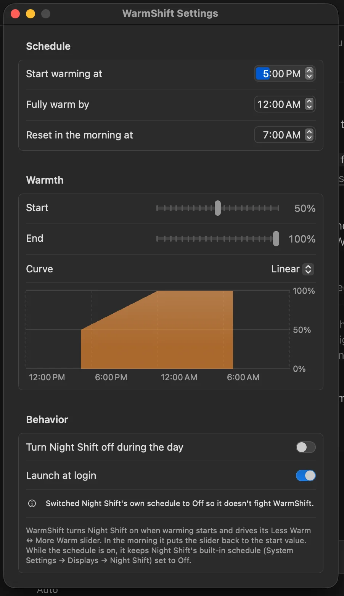

# Using the app

WarmShift lives in the menu bar. It has no Dock icon and no main window: everything is in the
small menu and the settings window.

## The menu bar icon

| Icon | Meaning |
|---|---|
| ☀︎ sun | Daytime, or WarmShift is paused. It isn't changing anything right now. |
| ☾ moon and stars | Evening or night. WarmShift is warming the screen or holding it warm. |

On a MacBook with a notch, crowded menu bars can hide icons behind the notch. If you can't see
WarmShift, quit a few other menu bar apps or use a menu bar manager.

## The menu

Click the icon to open it:

```
┌──────────────────────────────────────┐
│ WarmShift                     [ ●  ] │  ← on/off switch
│ Warming · reaches 100% at 10:00 PM   │  ← what's happening now
│ ▬▬▬▬▬▬▬▬▬▬▬▬▬▬▬▬▬▬▬▬▬▬▬▬▬▬▬▬         │
│ Less warm  Night Shift 72% More warm │  ← current warmth
├──────────────────────────────────────┤
│ Settings…                       Quit │
└──────────────────────────────────────┘
```

- **The switch** turns the schedule on or off. When it's off, WarmShift doesn't touch Night Shift
  at all; everything stays as it is until you turn it back on. Use it when you're editing photos
  or watching something where colour matters.
- **The status line** says which part of the day you're in and what comes next:
  - *Daytime · ramp starts at 7:00 PM*
  - *Warming · reaches 100% at 10:00 PM*
  - *Holding at 100% until 7:00 AM*
  - *Paused*
- **The bar** shows Night Shift's current warmth, from less warm on the left to more warm on the
  right, with the exact percentage underneath. It's read from Night Shift itself, so it also
  shows changes you make in System Settings.
- **Settings…** opens the settings window.
- **Quit** stops WarmShift. Night Shift stays at whatever warmth it had.

## The settings window



Changes take effect straight away; there's no Save button. If you move a time or slider during
the evening, the screen moves to the new warmth within a few seconds.

### Schedule

- **Start warming at**: when the evening begins. Night Shift turns on at the start warmth.
- **Fully warm by**: when the screen reaches the end warmth.
- **Reset in the morning at**: when the night ends and the slider goes back to the start warmth.

Click the hours or minutes and type, or use the arrows. [How the schedule works](Schedule.md)
explains what happens between these times. If the times can't work together, an orange warning
appears under them; see [Troubleshooting](Troubleshooting.md#reset-must-come-after-fully-warm-by).

### Warmth

- **Start** and **End**: how warm the screen is at the start and end of the evening, in 5% steps.
  These are the same as Night Shift's slider in System Settings: 0% is the far *Less Warm* end,
  100% the far *More Warm* end. The default goes from 50% (the middle) to 100%.
- **Curve**: how the warmth moves between the two:
  - **Linear** changes at the same pace the whole way.
  - **Ease in and out** starts slowly, speeds up in the middle and slows down again near the end.
- **The chart** shows warmth over a whole day, from noon to noon so the night reads left to right.
  The coloured area is when WarmShift is in charge; the empty parts are daytime.

### Behavior

- **Turn Night Shift off during the day**: when the night ends, also switch Night Shift off.
  If this is off (the default), Night Shift stays on during the day at the start warmth.
- **Launch at login**: start WarmShift when you log in. See
  [Installing](Installing.md#starting-it-at-login).
- A note appears here if WarmShift has switched Night Shift's own schedule to Off. That's
  expected; see [WarmShift and Night Shift](Night-Shift.md).

---
Next: [How the schedule works](Schedule.md)
